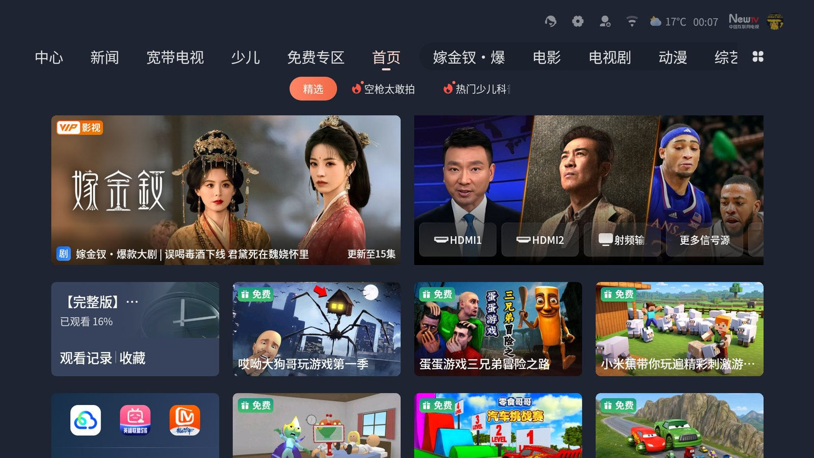
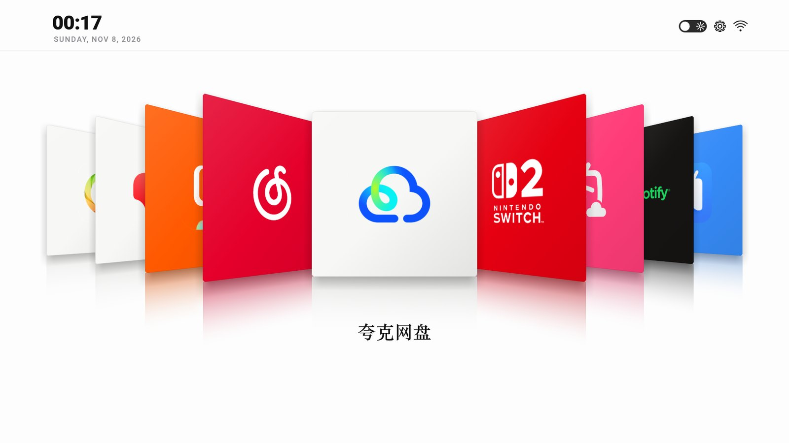
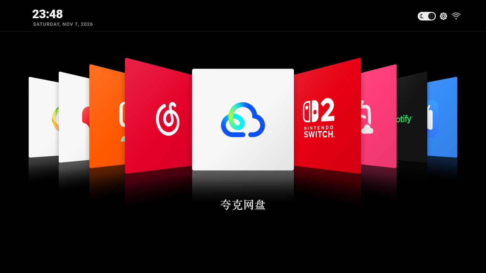
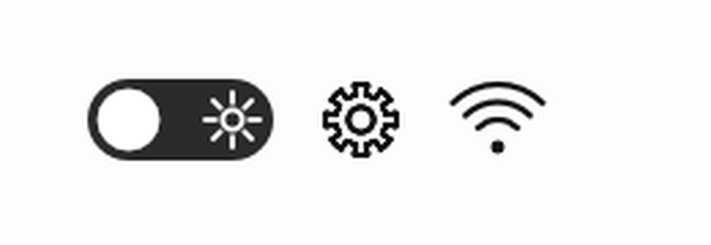

<p align="center">
  
  
</p>

<p align="center">
  
  
</p>

<p align="center">
  <a href="README.zh-CN.md">简体中文</a> ·
  <a href="screenshots/">Screenshots</a> ·
  <a href="#quick-start">How to install</a> ·
  <a href="docs/MODELS.md">Compatible TVs</a> ·
  <a href="docs/ADAPT.md">Adapt to your TV</a> ·
  <a href="docs/HOW-IT-WORKS.md">How it works</a> ·
  <a href="docs/FAQ.md">FAQ</a>
</p>

---

> Cover Flow as a TV home screen. A single custom `View` that puts your apps on a
> mirror-black floor — 3D tiles, baked shadows, reflections that never stack colour,
> light and dark, real app names. No WebView, no libraries, no root, 180 KB.
>
> 把电视首页做成 Cover Flow。一个自定义 View 画完所有东西：3D 卡片、烘死的阴影、
> 不会互相叠色的落地倒影、深浅两套主题、从系统读取的真实应用名。没有 WebView、
> 没有第三方库、不需要 root，装上 180 KB。


▶ **MIT, do what you want with it.** Fork it, ship it, just keep the notice.<br>
▶ **Your TV stays yours.** Nothing is uninstalled — the stock launcher is still on the device and comes back with one command.<br>
▶ **New here?** Read **[docs/ADAPT.md](docs/ADAPT.md)** — it is almost always the package name that trips people up.<br>

---

## Before / After

| Stock ad-filled home | iPodTVStyle |
| :---: | :---: |
|  |  |

Smooth on low-end TV SoCs because everything expensive — card shadows, mirror
reflections, icons — is **baked into bitmaps once at startup**. The render loop only
warps prefabbed textures into projected quads.

---

## What you get

- **Cover Flow carousel** — 9 tiles in 3D perspective, the centre tile overlaps its
  neighbours, arrow keys slide with a 420 ms eased transition.
- **Glossy floor reflections** — each tile sits on a blurred mirror image. Because every
  texture carries an opaque floor patch, the tile nearest the centre always erases the
  one behind it: reflections never stack colour.
- **Light / dark theme** — one tap, remembered across reboots.
- **Real app names** — pulled from `PackageManager`, so Chinese apps show Chinese names
  and English apps show English names, in a serif face.
- **Live clock** — big and bold, Roboto Black from the system.
- **Offline, no root, reversible.** Nothing is uninstalled.

<p align="center">
  
</p>

---

## Requirements

| | |
|---|---|
| TV | Android TV / Google TV, **Android 8.0 (API 26)** or newer — see the [457-model list](docs/MODELS.md) |
| ADB | enabled over Wi-Fi (Developer options → Network debugging) |
| Build | JDK 17 + Android SDK 34, or just open `launcher/` in Android Studio |

---

## Quick start

A computer on the same network as the TV, plus a coding agent that can run terminal
commands — Claude Code, Codex or Gemini CLI (Codex is used in the examples below).

### 1 · On the TV

Two things to do: **write down the pairing details**, then **enable ADB debugging**.

**Write down the pairing details**

Open Settings and find the "About this TV" entry; note the **model name**. Then open the
connected Wi-Fi and check its **network details** for the **IP address** (e.g. `192.168.1.50`).

These two are what lets the agent talk to your TV.

**Enable ADB debugging**

The exact route differs per model. Most TVs enter developer mode when you press the
**build number seven times**; if that does not apply, search "<model> + adb" — the method
is usually documented in a community post.

On a Skyworth set, for example: open "About this TV" and press **up, up, down, down, left,
right, left, right** on the remote to enter developer mode, then switch on debugging.

### 2 · On the computer

Make sure the computer is on the **same Wi-Fi** as the TV.

Send the repository address together with the block below to your agent. **The only thing
to edit is the IP.** The agent clones the repo, builds, installs and sets it as the default
home screen; if the TV asks to allow debugging, confirm with the remote.

```text
Please replace my TV's home screen with iPodTVStyle.

Repository: https://github.com/yesyflami/iPodTVStyle
TV IP: ___

Steps:
1. Clone the repository above and open the project locally
2. adb connect ___  and confirm `adb devices` lists it as "device"
3. Follow docs/ADAPT.md in the repo exactly. Do not invent steps
4. Before changing anything, record the stock launcher for later rollback:
   adb shell cmd package resolve-activity -c android.intent.category.HOME
5. Work out this TV's HOME policy and tell me the conclusion before continuing
6. Edit homeApplicationId in launcher/gradle.properties
7. Run ./tools/build.sh, then ./tools/install.sh ___ to install and set as home
8. Hand me the complete restore command at the end

Rules:
- Never uninstall system apps, never root, do not run adb kill-server
- On INSTALL_FAILED_UPDATE_INCOMPATIBLE, stop and tell me instead of forcing it
```

When it finishes, press **HOME** on the remote and pick iPodTVStyle.

If it never shows up in the desktop picker, that model has an allow-list restriction —
see [docs/ADAPT.md](docs/ADAPT.md) §1.

---

## Make it yours

| What | Where |
|---|---|
| Apps in the carousel (name, package, icon, tile colour, logo size) | `launcher/app/src/main/java/com/yesy/carouselhome/CarouselView.java` → `apps[]` |
| Home package the TV expects | `launcher/gradle.properties` → `homeApplicationId` |
| Clock font, date format | same Java file → `drawHeader()` |
| Animation length, tilt, spacing | same Java file → constants block at the top |
| Serif subset for app names | `assets/app_name_serif.ttf` + `tools/make-font-subset.py` |

Full walkthrough — including pulling icons off your own TV — in
**[docs/ADAPT.md](docs/ADAPT.md)**.

---

## How it works

Perspective-projected quads on a single `Canvas`, camera maths carried over from the CSS
version of this design, plus a few compromises for old TV GPUs. Before changing the
renderer, read **[docs/HOW-IT-WORKS.md](docs/HOW-IT-WORKS.md)**: the projection, the bake
pipeline, the occlusion clipping and the frame budget are all explained there.

<p align="center">
  
</p>

---

## Credits

▶ **[CleanYourTV](https://github.com/Gathin23/cleanyourtv)** by [@Gathin23](https://github.com/Gathin23) — the project that proved an ad-filled Android TV home screen can be replaced over Wi-Fi without root, and one command to undo. If you also want the bloatware gone, start there and use iPodTVStyle as the replacement home screen.<br>
▶ The visual language is a love letter to the 2007 iPod nano / iTunes Cover Flow.<br>
▶ Roboto Black and Roboto Medium are read from `/system/fonts` at runtime, not bundled. The serif subset is derived from Songti SC — see [NOTICE.md](NOTICE.md).

## License

MIT, see [LICENSE](LICENSE). App names and logos in the screenshots belong to their
owners and are **not** covered by that licence — see [NOTICE.md](NOTICE.md).

<p align="center"><sub>简体中文说明 → <a href="README.zh-CN.md">README.zh-CN.md</a></sub></p>
