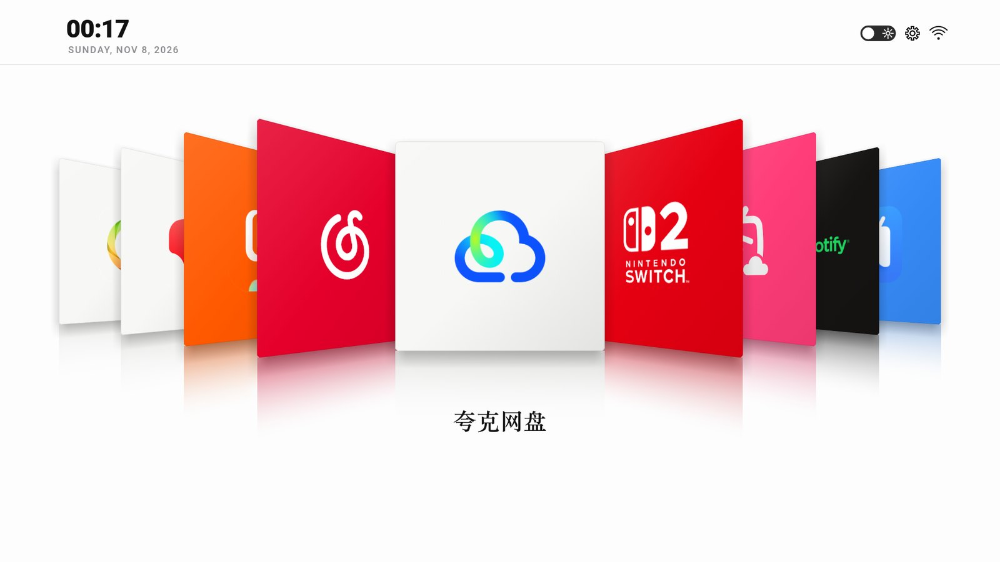
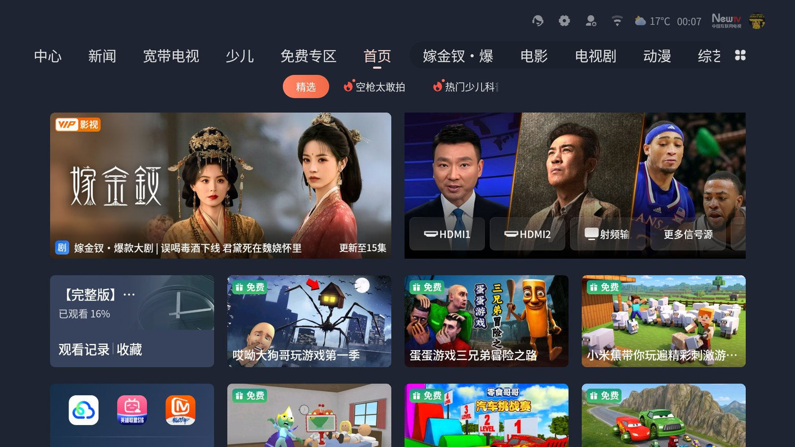
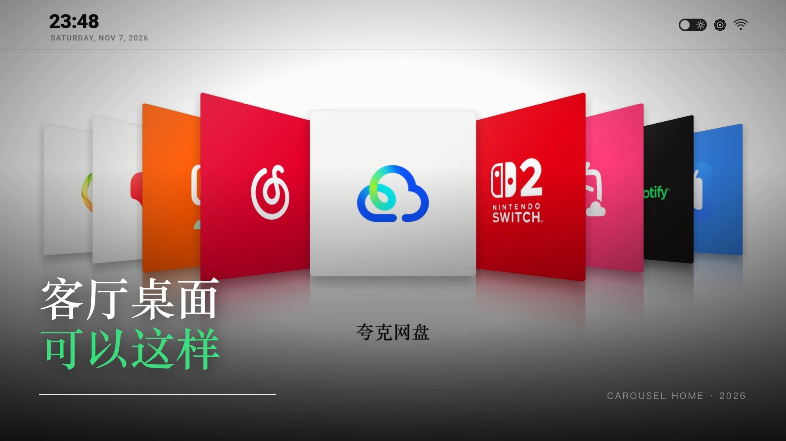

> **iPodTVStyle** — 把任意 Android TV 变成 iPod 风格的 Cover Flow 首页。

<p align="center">
  
</p>

<p align="center">
  <a href="README.md">English</a> · <a href="docs/ADAPT.md">适配你的电视</a> · <a href="docs/FAQ.md">常见问题</a>
</p>

---

## 之前 / 之后

| 原厂首页（信息流 + 广告位） | iPodTVStyle |
|---|---|
|  |  |

整套 UI 是**一个自定义 View + 一块 Canvas**，没有 WebView、没有第三方依赖，
APK 只有 180 KB。能在低端电视 SoC 上跑顺，是因为所有昂贵的东西 ——
卡片阴影、落地倒影、图标 —— 都在启动时**一次性烘焙成位图**，
每帧只做"把预制贴图按投影矩阵贴到四个角上"。

宣传片（10 秒）：

<p align="center">
  <a href="promo/tv-home-promo.mp4"></a>
</p>

---

## 你会得到什么

- **Cover Flow 卡片轮播** —— 9 张卡片按 3D 透视排布，中间那张压住两侧邻居，
  方向键切换带缓动
- **玻璃地板倒影** —— 每张卡片下方是自己模糊后的镜像，向下淡入背景。
  倒影之间**不会叠色**：每张贴图里都烘焙了一块不透明的地板色，
  更靠中间的卡片天然把外侧的残留盖掉
- **深浅两套主题** —— 一键切换，重启后记住
- **真实应用名** —— 从 `PackageManager` 读取，中文应用显示中文、英文显示英文，
  衬线字体渲染
- **大号时钟** —— Roboto Black
- **完全离线、不需要 root** —— 不卸载任何东西，原厂桌面还在机器里，一条命令就能回去

---

## 环境要求

| | |
|---|---|
| 电视 | Android TV / Google TV，**Android 8.0（API 26）** 及以上 |
| ADB | 已开启网络调试（设置 → 开发者选项） |
| 构建 | JDK 17 + Android SDK 34，或直接用 Android Studio 打开 `launcher/` |

---

## 三步跑起来

```bash
# 1. 连电视（IP 在 设置 → 网络 里看）
adb connect 192.168.1.50:5555
adb devices

# 2. 改包名：launcher/gradle.properties → homeApplicationId（最重要的一步）
#    不知道填什么？见 docs/ADAPT.md

# 3. 编译、安装、启动
cd launcher
./gradlew assembleRelease
adb install -r app/build/outputs/apk/release/app-release.apk
adb shell am start -n <homeApplicationId>/com.gathin.tvhome.MainActivity
```

然后按遥控器 **HOME 键** → 选 iPodTVStyle → 选"始终"。

如果它压根没出现在 HOME 选择器里，99% 是包名没对上，
看 **[docs/ADAPT.md](docs/ADAPT.md)**。

### 想换回原厂桌面

```bash
adb uninstall <homeApplicationId>
# 或者手动指回去
adb shell cmd package set-home-activity com.tianci.movieplatform/com.coocaa.homepage.vast.HomePageActivity
```

---

## 改成你自己的样子

| 想改什么 | 改哪里 |
|---|---|
| 轮播里的应用（名字、包名、图标、卡片底色、logo 大小） | `launcher/app/src/main/java/com/yesy/carouselhome/CarouselView.java` 的 `apps[]` |
| 电视认的 HOME 包名 | `launcher/gradle.properties` → `homeApplicationId` |
| 时钟字体、日期格式 | 同一个 Java 文件的 `drawHeader()` |
| 动画时长、倾斜角度、卡片间距 | 同一个文件顶部的常量区 |
| 应用名字体（衬线子集） | `assets/app_name_serif.ttf` + `tools/make-font-subset.py` |

完整流程见 **[docs/ADAPT.md](docs/ADAPT.md)** —— 包括怎么从你自己的电视上
把应用图标抠出来、怎么重新生成字体子集。

---

## 原理

一块 `Canvas` 上画 3D 透视四边形，摄像机参数照搬了这个设计的 CSS 版本，
另外加了几处针对老旧电视 GPU 的妥协。要改渲染逻辑的话先看
**[docs/HOW-IT-WORKS.md](docs/HOW-IT-WORKS.md)**：投影公式、烘焙流程、
遮挡裁剪、帧预算都在里面。

---

## 致谢

- **[CleanYourTV](https://github.com/Gathin23/cleanyourtv)** / [@Gathin23](https://github.com/Gathin23) ——
  这个项目证明了"不 root、纯 Wi-Fi、一行命令可还原"地把广告首页换掉是可行的，
  也让我第一次觉得这件事自己也能做。如果你还想清掉预装臃肿软件，
  从那边开始，再把 iPodTVStyle 当作替换的桌面。
- 视觉语言致敬 2007 年的 iPod nano / iTunes Cover Flow。
- Roboto Black / Medium 是 Android 自带字体，直接从 `/system/fonts` 读取。
  内嵌的衬线子集来自 Songti SC，见 [NOTICE.md](NOTICE.md)。

## 许可

MIT，见 [LICENSE](LICENSE)。
截图里出现的应用名称与图标归各自所有者，见 [NOTICE.md](NOTICE.md)。
